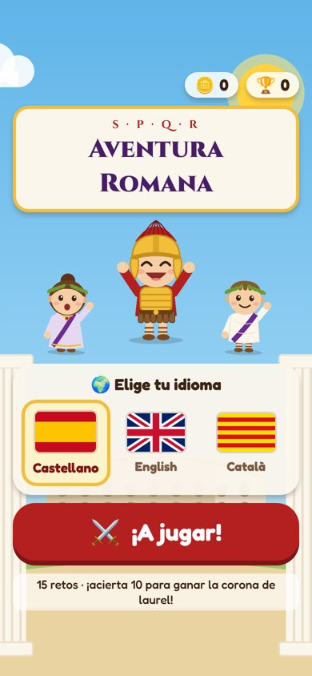
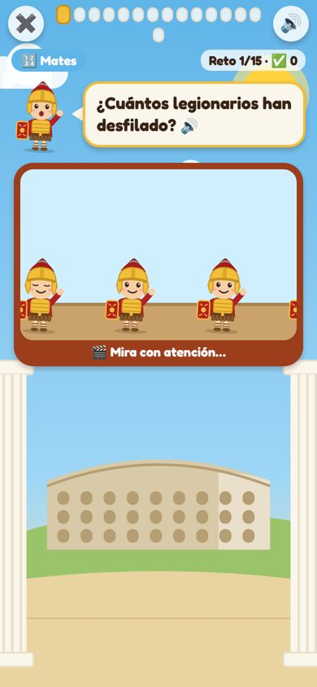
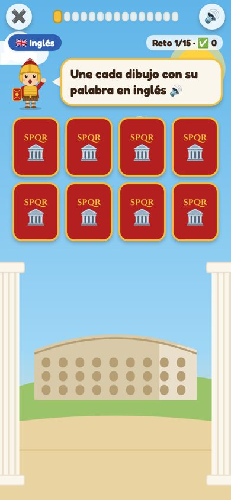
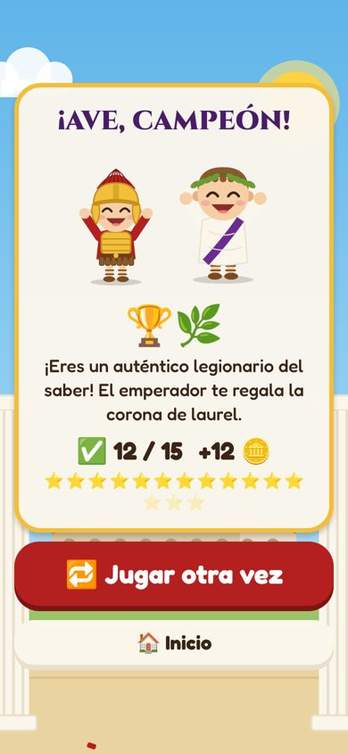
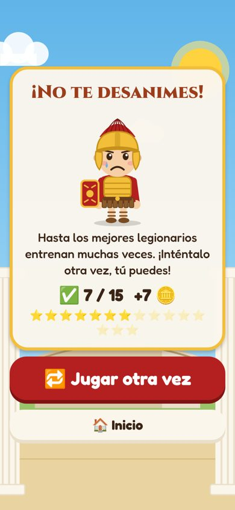

# 🏛️ Aventura Romana

App educativa para niños de 2.º de primaria (7-8 años) ambientada en la antigua Roma.
Mates, historia (España, Cataluña, Argentina y Roma), inglés y catalán, con juegos muy visuales.
Funciona en **iOS y Android**, **sin conexión a internet**, y en **castellano, inglés y catalán**.

| Inicio | Vídeo animado | Memoria | ¡Ganaste! | ¡Otra vez! |
|---|---|---|---|---|
|  |  |  |  |  |

(Capturas reales de la app, en `docs/capturas/`.)

## Cómo se juega

- Al abrir la app se elige el idioma con las banderas (🇪🇸 castellano, 🇬🇧 inglés, senyera para el catalán) y se pulsa **¡A jugar!**
- Cada partida tiene **15 retos nuevos**: 5 de mates, 3 de historia, 2 de Roma, 3 de inglés y 2 de catalán.
- Los tipos de reto se van alternando (nunca dos iguales seguidos):
  - 👍👎 **Verdadero o falso**
  - 🖼️ **Elegir entre opciones** (dibujos, banderas o palabras)
  - 🔢 **Cuentas** con dibujos o con teclado numérico
  - 🎬 **"Vídeos"**: escenas animadas (desfile de legionarios, cofre de monedas con un águila ladrona, carrera de cuadrigas, reloj, series) que se miran y luego se responden
  - 🃏 **Memoria** (parejas), ↕️ **ordenar**, 👆 **tocar todos los…**, 🔤 **deletrear** palabras en inglés/catalán
  - 🔊 **Escuchar**: la palabra suena y hay que tocar el dibujo
- Las preguntas se **leen en voz alta** (se puede silenciar con 🔊).
- Unas 3 veces por partida aparece un **romanito con una curiosidad** («¿Sabías que…?»).
- Al final:
  - **10 o más aciertos** → el legionario y el emperador saltan de alegría, confeti y corona de laurel 🏆
  - **menos de 10 (más de 5 fallos)** → un legionario triste le anima a volver a intentarlo
- Cada acierto da una moneda 🪙 y cada partida ganada una corona 🏆 (se guardan en el móvil).

## Para probarla en un ordenador

```bash
cd aventura-romana
npm install
npx expo start          # escanear el QR con Expo Go (iOS/Android), o pulsar "w" para verla en el navegador
```

## Instaladores para iOS y Android

Ver **[INSTALAR.md](INSTALAR.md)**: GitHub genera automáticamente el `.apk` (Android) y el `.ipa` (iOS).

## Comprobaciones

```bash
npx tsc --noEmit                    # tipos
npx expo lint                       # estilo
npx tsx scripts/check-sessions.ts   # genera 3000 partidas y valida todas las preguntas
```

## Estructura

```
App.tsx                      navegación (inicio → partida → resultado) y progreso guardado
src/i18n.ts                  textos de la interfaz en es / en / ca
src/theme.ts                 colores y tipografías romanas
src/sound.ts                 efectos de sonido, vibración y voz
src/storage.ts               monedas, coronas e idioma (guardado en el móvil)
src/components/              Romanito (personaje SVG), fondo, banderas, reloj, botones, confeti…
src/games/                   un componente por tipo de reto
src/questions/content.ts     preguntas escritas a mano (historia, Roma, catalán, inglés)
src/questions/vocab.ts       vocabulario para inglés y catalán
src/questions/math.ts        generadores de mates (números nuevos en cada partida)
src/questions/languages.ts   generadores de inglés y catalán
src/questions/facts.ts       curiosidades de Roma
src/questions/session.ts     arma cada partida de 15 retos
scripts/make-sounds.js       genera los sonidos (WAV) sin archivos de terceros
scripts/icon.svg             icono de la app
```

### Añadir preguntas

Añade un objeto a `src/questions/content.ts` con el texto en los tres idiomas. Ejemplo:

```ts
{
  id: 'rome-sandals', subject: 'rome', kind: 'tf', scene: '🏛️🩴',
  prompt: { es: 'Los romanos llevaban sandalias.', en: 'Romans wore sandals.', ca: 'Els romans portaven sandàlies.' },
  answer: true,
},
```

Después ejecuta `npx tsx scripts/check-sessions.ts` para validar.

## Privacidad

La app no tiene anuncios, no pide cuentas, no recoge datos y en Android ni siquiera tiene permiso de internet.
Lo único que guarda (en el propio móvil) es el idioma, las monedas y las coronas.
